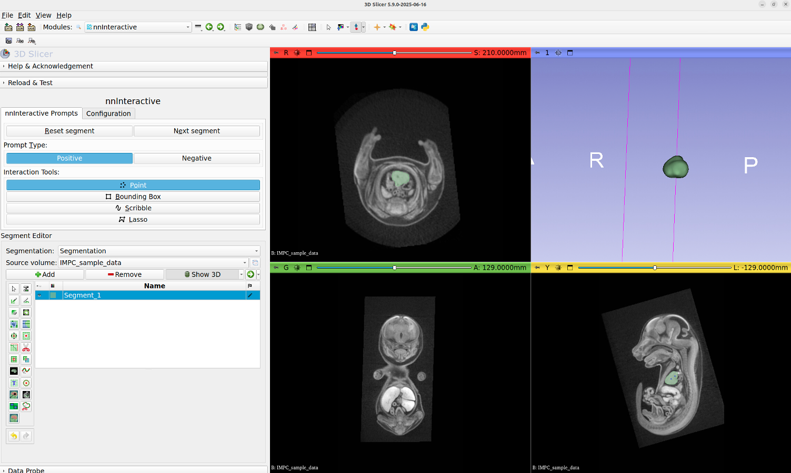

# Using the nnInteractive extension on MorphoCloud instances

nnInteractive is a deep learning-based framework for interactive segmentation of 3D images, allowing for fast
voxel-wise segmentation using prompts like points, scribbles, bounding boxes, and lasso. It is a very useful and
effective tool for rapid 3D segmentation with few clicks.

On MorphoCloud instances, the **nnInteractive** and **PyTorch** extensions are already installed in Slicer.
nnInteractive runs in **local mode**: the model runs inside Slicer, on the instance's GPU. You do not need to
install or start a separate server.

The official repository and the most up-to-date instructions are at
https://github.com/coendevente/SlicerNNInteractive. This guide covers the steps known to work on MorphoCloud.

## First use on an instance (once per instance)

1. Open the `nnInteractive` module (CTRL+F, then search for nnInteractive).
2. The first time you open it, a dialog asks what to install. Choose **Full (local + remote)**. This installs the
   nnInteractive package and PyTorch into Slicer's Python. It takes a few minutes. If Slicer asks to restart during
   the installation, restart it; the installation continues by itself.
3. When the installation finishes, **quit Slicer and start it again** before you segment, even if Slicer already
   restarted once during the installation. Without this restart,
   starting nnInteractive fails with:
   `Could not start nnInteractive (local mode): 'numpy.ufunc' object has no attribute '__module__'`
4. In the `Configuration` tab, check that a model is selected. The model's weights are downloaded automatically the
   first time you segment.

You only need to do this once per instance: Shelve and Unshelve keep it. A new instance (for example after Delete,
or after changing the instance type) needs it again, because the installation lives in Slicer on the instance, not
in your storage.

## Using the nnInteractive extension

We will be using a low-resolution diceCT scan of a mouse embryo as sample data. Use the **Load Data from URL**
feature of the `Sample Data` module: paste this address into the URL field and press `Import`:
https://raw.githubusercontent.com/SlicerMorph/SampleData/master/IMPC_sample_data.nrrd

1. Go to the `nnInteractive` module, `nnInteractive Prompts` tab, and click **Initialize** at the top. This is
   required before any prompt can be placed: it loads the model and the current image. It can take a moment; the
   interaction tools stay disabled until it finishes, and the button then shows `Uninitialize`.
2. Make sure the source volume is `IMPC_sample_data` (or the volume you want to segment, if you are using your own
   data).
3. To create the first segment, click `Next segment`, which creates Segment_1. Make sure the prompt type is
   **Positive** and select the **Point** tool. Place a point in the center of the heart (see the screenshot). This
   starts the segmentation. Click the **Show 3D** button of the Segment Editor section in the bottom half of the
   module to see the segmentation in the 3D view.

While this prompt selected the ventricle and the bulk of the heart, it left the atrium out. To add it to the
segmentation, place another point prompt on the atrium. Review the segmentation in other slices and planes, and if
you find a region you want to remove from it, switch to a **Negative** prompt and place a point in that region.
This is the primary mode of operation in nnInteractive: as you guide the model with positive and negative prompts,
the segmentation follows what you want more accurately. `Ctrl+Z` undoes the last prompt.

When you are satisfied with the heart, click `Next segment` to create a new segment. This time try segmenting the
liver (the brightest structure), and experiment with the other prompt types, such as scribble, bounding box or lasso.

Save your segmentation in your storage (Desktop, Documents or Downloads, all in `/media/share/MyDrive`), so that it
is kept when the instance is deleted.
