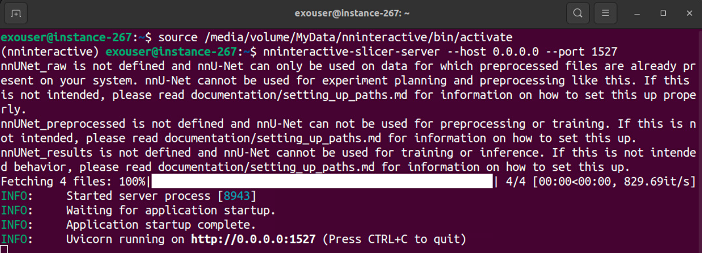

# Setting & Using NNInteractive extension on the MorphoCloud instances
nnInteractive is a deep learning-based framework for interactive segmentation of 3D images, allowing for fast voxel-wise segmentation using prompts like points, scribbles, bounding boxes, and lasso. It is a very useful and effective tool for rapid 3D segmentation with few clicks. It is a little different from the typical Slicer extensions, because it is a client and server application. While Slicer installation on the MOrphoCloud instances come with SlicerNNInteractive, that's only the **client**; you still have to install and then run the server each time you are planning to use NNInteractive. 

The official repository and most up-to-date instructions on how to install NNInteractive can be found at https://github.com/coendevente/SlicerNNInteractive/blob/main/README.md. This guide covers specific steps specific known to work with on MorphoCloud.

## Installing the server and running it.
There are two primary ways of running the server: Either using docker (if available) or pip install (to your user space). Both work fine on MorphoCloud

**Install NNInteractiveServer via pip**

1. Open a terminal window 
2. To create a python virtual environment specific to NNinteractive copy and paste this command to the terminal window (one-time only)
```
python3 -m venv /media/volume/MyData/nninteractive
```
3. To activate this python virtual enviroment copy and paste this command to the terminal window (everytime you want to run the server)
```
source /media/volume/MyData/nninteractive/bin/activate
```
4. To install the NNinteractive server copy and paste this command to the terminal window (one-time only)
```
pip install "nninteractive-slicer-server" "nnunetv2<2.7"
```
5. To start the NNinteractive server copy and paste this command to the terminal window (everytime you want to run the server)
```
nninteractive-slicer-server --host 0.0.0.0 --port 1527
```

**Install NNInteractiveServer via Docker**

1. Open a terminal window and type: 
```
docker pull coendevente/nninteractive-slicer-server:latest
```
Pulling the docker images and extracting them will take a few minutes, but this is a one time operation. 

2. To activate the installed server type:
```
docker run --gpus all --rm -it -p 1527:1527 coendevente/nninteractive-slicer-server:latest
```
Regardless of the method you chose, if you successfully installed the NNInteractive server and started it, your terminal window should be displaying an output like this.:



As shown in the screenshot, the server is now successfully running and will continue to run unless you hit CTRL+C (quit), close the terminal window, or your instance shelves. Also, once you completed these steps, to run the server next time (e.g., after an unshelving) you need to open to start the server again. This will depend on the method you chose to install if. If you used **pip**, then **copy and paste the commands in steps 3 and 5 only** (no need to recreate the environment or reinstall the server). If you used docker, you should run the second command `docker run....`

## Configuring the NNInteractive Slicer Extension
NNInteractive extension comes automatically installed with the Slicer installation in the MorphoCloud instances. However, if any reason you cannot find the NNInteractive module (CTRL+F then search for NNInteractive), you can always use the Extension Manager (CTRL+4) mechanism to reinstall it. 

Before you can use the nnInteractive, make sure you started the server following the steps above. Also you need to configure the server address in the nnInteractive extension (this is usually a one-time setting). To do that, click on the `Configuration` tab and type this as the server URL field: `http://0.0.0.0:1527`

Now, NNInteractive extension should be ready to be used. 

## Using nnInteractive Extension
We will be using low-resolution diceCT scan of a mouse embryo as a sample data. You can use the **Load Data from URL** feature of the `SampleData` module to obtain the sample data. Just copy and paste this address to the URL field and hit `Import`: https://github.com/SlicerMorph/SampleData/blob/master/IMPC_sample_data.nrrd. I

Now go to NNInteractive module, and make sure you are on the `Interactive Prompts` tab. If no segmentation has been specified, from the drop down choose **Create a new segmentation** option. Make sure that the **Source Volume** is set to IMPC_Sample_Data (or whatever volume you are trying to segment, if you are using your own dataset).

To create the first segment hit the `Next segment` button, which will create Segment_1. Make sure your **Prompt Type** is positive and from the **Interaction Tools** select the **Point** mode. Place a point in the center of the heart (see the screenshot). This will initiate the segmentation process. Click the **Show 3D** button of the segment editor widges in the bottom half of the screen to make the resultant segmentation visible in the 3D view. 


While this prompt selected all the ventricle and bulk of the heart, it left the atrium out. To add that to the segmentation, place another point prompt on the atrium. Go ahead and review the segmentation in other slices and planes, and if you encounter any region that you want to remove from the existing segmentation, switch to **Negative** prompt and place point prompt to exclude the region. This is the primary mode of operation in NNInteractive, as you guide the model with positive and negative prompt it will learn what you want to segment more accurately. 

When you are satistifed with the heart segmentation, click the `Next Segment` button to create a new segment. This time try segmenting the liver (the brightest structure), and experiment with other prompt types such scribble, or lasso.
