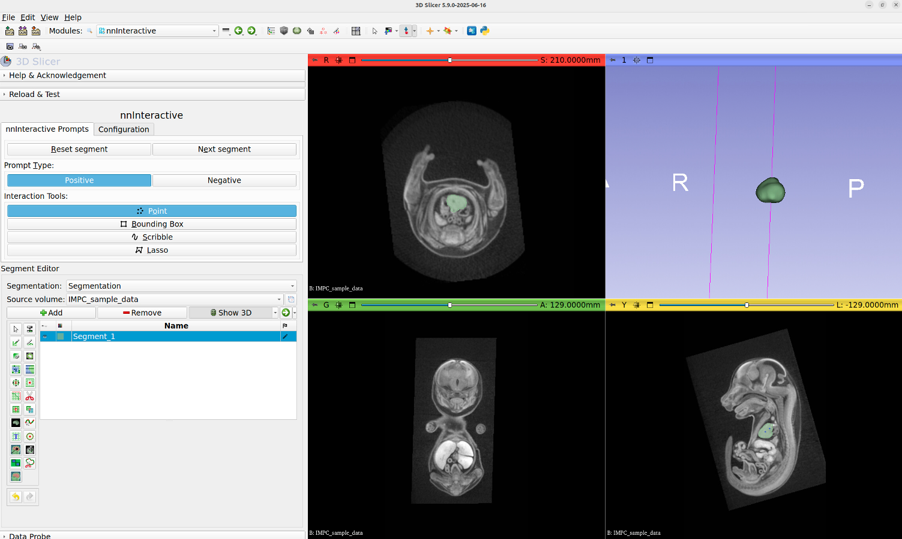

# MorphoCloud

  

MorphoCloud gives SlicerMorph users **on-demand, GPU-enabled cloud workstations**: full
[3D Slicer](https://download.slicer.org) + [SlicerMorph](https://slicermorph.org) desktops running on
[JetStream2](https://jetstream-cloud.org/) and reachable from any web browser. You manage your instance and
your files on the MorphoCloud portal, **[portal.morphocloud.org](https://portal.morphocloud.org)**, so it is
well suited to occasional high-performance work, AI-assisted segmentation, and teaching.

> **The authoritative documentation is the [MorphoCloud user guide](https://github.com/MorphoCloud/docs/blob/main/user-guide/README.md)**,
> linked from [morphocloud.org](https://morphocloud.org). This page is only a short orientation for SlicerMorph
> users. For anything beyond it (connecting, file transfer, storage, instance types, GPU notes), use the
> user guide, as it is kept current.

## Before you start: become a member

MorphoCloud is members-only. Joining is free. You need an [ORCID iD](https://orcid.org/register) and a
[GitHub account](https://github.com/signup).

1. On [morphocloud.org](https://morphocloud.org), click **New user? Join →**. It opens
   [join.morphocloud.org](https://join.morphocloud.org).
2. Click **Sign in with ORCID**, then sign in with GitHub. Both sign-ins are required.
3. Fill in the form, agree to the [Terms of Use](https://github.com/MorphoCloud/docs/blob/main/terms.MD), and
   press **Submit**.
4. Click the verification link in the email from no-reply@morphocloud.org. This sends your GitHub invitation.
5. Sign in to the [portal](https://portal.morphocloud.org) with GitHub and accept the invitation there. The
   portal then opens your dashboard.

Every step is in [Getting started](https://github.com/MorphoCloud/docs/blob/main/user-guide/getting-started.md).
Membership lets you *request* instances; it does not guarantee that a machine is free at any given moment.

## The core idea

- **Everything happens on the portal.** You use the buttons on [portal.morphocloud.org](https://portal.morphocloud.org)
  (Create, Shelve, Unshelve, Extend session, Delete); you don't type commands on GitHub. You have one
  instance at a time.
- **Your files live in your storage, MyDrive** (100 GB, no backup), not on the instance. On an instance it is
  at `/media/share/MyDrive`, and your Desktop, Documents and Downloads folders are in it. Everything in MyDrive
  is kept when the instance is deleted; anything saved anywhere else is lost with the instance. Create your
  storage once, with **Create my storage** on the portal.
- **Create an instance** by choosing a type and pressing **Create instance**. The default, `g3.large`, covers
  most SlicerMorph work. It usually takes about 10 minutes, and an email tells you when it is ready.
- **Connect** with the access details on the instance's card: **Web connect** in the browser,
  [TurboVNC](https://github.com/TurboVNC/turbovnc/releases) (recommended for visualization), or SSH.
- **Sessions.** A running instance shelves itself when its session ends: after 4 hours, or 2 hours on `g3.xl`,
  `g4.xl`, `r3.large` and `r3.xl`. Press **Extend session** on the card, or **Yes** on the reminder on the
  desktop, to keep it running. Shelve it yourself when you are done, and Unshelve it to continue.
- **Check availability first.** JetStream2 is a nationally shared cloud, and GPU machines are often scarce.
  The line at the top of the portal shows how many machines of each type are free; check it before you create
  or unshelve.
- **Getting help.** The **MorphoCloud Chatbot** on the portal answers questions about MorphoCloud, your
  instance and 3D Slicer, and can send the conversation to the MorphoCloud team. You can also email
  [portal@morphocloud.org](mailto:portal@morphocloud.org).

   
  <em>3D Slicer + SlicerMorph running on a MorphoCloud cloud desktop, used entirely in the browser.</em>

## Where to go next

| You want to…                                         | Go to |
| ---------------------------------------------------- | ----- |
| Become a member                                      | [join.morphocloud.org](https://join.morphocloud.org) |
| Create or manage an instance, your files             | [portal.morphocloud.org](https://portal.morphocloud.org) |
| See how many machines of each type are free          | the line at the top of the [portal](https://portal.morphocloud.org) |
| Full user guide (connecting, storage, file transfer) | [MorphoCloud user guide](https://github.com/MorphoCloud/docs/blob/main/user-guide/README.md) |
| Choose an instance type                              | [GPU notes & known issues](https://github.com/MorphoCloud/docs/blob/main/user-guide/gpu-and-known-issues.md) |
| Run a workshop                                       | [Workshop access](https://github.com/MorphoCloud/docs#2-workshop-access) |
| Teach a course                                       | [Instructor guide](https://github.com/MorphoCloud/docs/blob/main/instructor/README.md) |
| AI-assisted segmentation on MorphoCloud              | [nnInteractive tutorial](NNInteractive.MD) |
